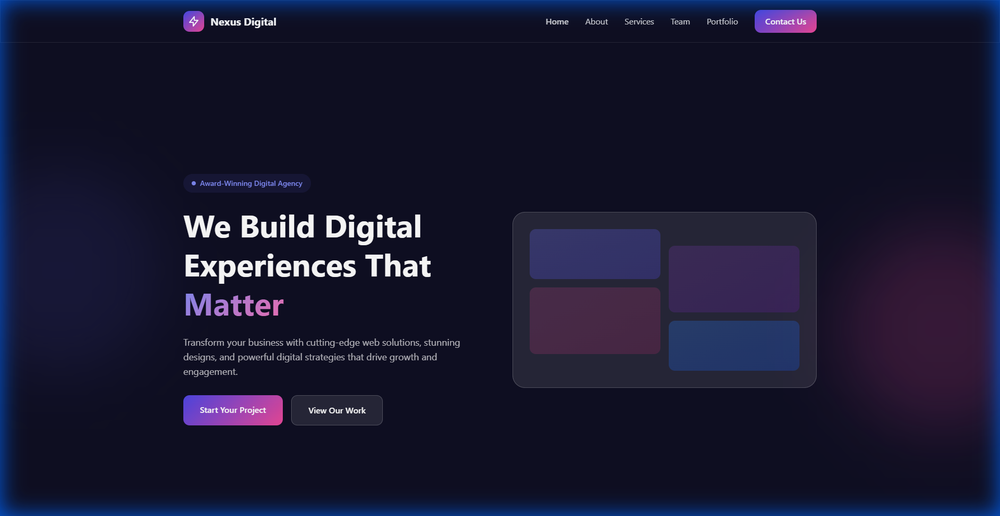
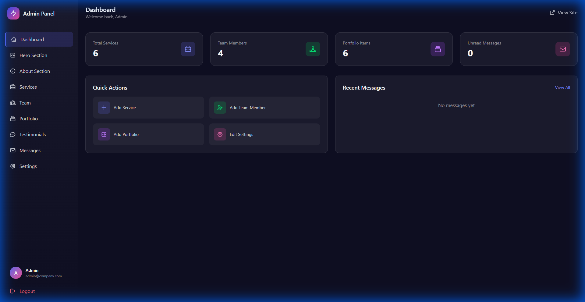

# 🏢 Laravel Company Profile Template

A modern, full-featured company profile website template built with Laravel 12. Perfect for agencies, startups, and businesses who need a professional online presence with a custom admin panel.


## 📚 Documentation

Panduan instalasi lengkap tersedia di folder [`docs/`](docs/):

- [System Requirements](docs/system-requirements.md)
- [Instalasi Native - Linux](docs/installation-native.md)
- [Instalasi Docker](docs/installation-docker.md)

## ✨ Features

### Frontend
- 🎨 **Modern Design** - Glassmorphism, gradients, and smooth animations
- 📱 **Fully Responsive** - Works on all devices
- ⚡ **Fast & Optimized** - Built with performance in mind
- 🎭 **AOS Animations** - Smooth scroll animations
- 🔍 **SEO Friendly** - Semantic HTML and meta tags

### Admin Panel
- 🔐 **Secure Authentication** - Built-in login system
- 📊 **Dashboard** - Stats overview and quick actions
- ⚙️ **Company Settings** - Logo, contact info, social links
- 🦸 **Hero Section** - Customize homepage hero
- 📝 **About Section** - Mission, vision, and stats
- 💼 **Services Management** - CRUD with features list
- 👥 **Team Management** - Staff profiles with social links
- 🖼️ **Portfolio** - Showcase projects with categories
- ⭐ **Testimonials** - Client reviews with ratings
- 📬 **Contact Messages** - View and manage inquiries

## 🛠️ Tech Stack

| Technology | Purpose |
|------------|---------|
| Laravel 12 | Backend Framework |
| Blade | Templating Engine |
| Tailwind CSS | Styling |
| Alpine.js | JavaScript Interactivity |
| AOS | Scroll Animations |
| MySQL | Database |
| Vite | Asset Bundling |

## 🚀 Quick Start

### Prerequisites
- PHP 8.2+ (8.5 recommended)
- Composer 2.7+
- Node.js 20.19+ atau 22.12+ (opsional, hanya untuk mengubah asset)
- MySQL 8.0+
- Docker Engine + Compose v2 (opsional, untuk mode Docker)

### Installation

1. **Clone the repository**
   ```bash
   git clone https://github.com/jeeexcalibur/company-profile-template.git
   ```

2. **Install dependencies**
   ```bash
   composer install
   # opsional, hanya jika ingin mengubah CSS/JavaScript
   npm install
   ```

3. **Environment setup**
   ```bash
   cp .env.example .env
   php artisan key:generate
   ```

4. **Configure environment and database** in `.env`
   ```env
   APP_PORT=8000
   APP_URL=http://localhost:${APP_PORT}
   SERVER_PORT="${APP_PORT}"

   DB_CONNECTION=mysql
   DB_HOST=127.0.0.1
   DB_PORT=3306
   DB_DATABASE=db_ar_profile
   DB_USERNAME=profile
   DB_PASSWORD=profile123
   ```

   Cukup ubah `APP_PORT` untuk mengganti port aplikasi; `APP_URL` dan `SERVER_PORT` mengikuti nilai tersebut.

5. **Run migrations and seed**
   ```bash
   php artisan migrate --seed
   # symlink storage tidak ikut di repository;
   # buat symlink setelah clone:
   ln -sfn ../storage/app/public public/storage
   ```

   Untuk data dokter, kategori PKRS, dan gambar placeholder, ikuti langkah seeder tambahan di [docs/installation-native.md](docs/installation-native.md).

6. **Build assets** (opsional jika `public/build` sudah tersedia)
   ```bash
   npm run build
   ```

7. **Start the server**
   ```bash
   php artisan serve
   ```

   Port mengikuti `SERVER_PORT` yang diturunkan dari `APP_PORT` di `.env`.

8. **Visit the site**
   - Frontend: http://localhost:8000
   - Admin: http://localhost:8000/admin/login

   Jika `APP_PORT` diubah, sesuaikan port pada URL di atas.

### Default Admin Credentials
```
Email: admin@company.com
Password: password
```
> ⚠️ **Important:** Change these credentials after first login!

## 📁 Project Structure

```
├── app/
│   ├── Http/Controllers/
│   │   ├── Admin/           # Admin panel controllers
│   │   └── Frontend/        # Public page controllers
│   └── Models/              # Eloquent models
├── database/
│   ├── migrations/          # Database schema
│   └── seeders/             # Demo data seeder
├── resources/
│   ├── css/                 # Tailwind CSS
│   ├── js/                  # Alpine.js setup
│   └── views/
│       ├── admin/           # Admin panel views
│       │   ├── layouts/     # Admin layout
│       │   ├── auth/        # Login page
│       │   ├── services/    # CRUD views
│       │   ├── team/        # CRUD views
│       │   ├── portfolio/   # CRUD views
│       │   ├── testimonials/# CRUD views
│       │   └── messages/    # Messages views
│       └── frontend/        # Public website views
│           ├── layouts/     # Main layout
│           └── partials/    # Reusable components
└── routes/
    └── web.php              # All routes
```

## 🎨 Customization

### Colors & Theme
Edit `resources/css/app.css` to customize the color palette:
```css
:root {
    --primary: 139, 92, 246;    /* Purple */
    --secondary: 59, 130, 246;  /* Blue */
    --accent: 236, 72, 153;     /* Pink */
}
```

### Content
All content is managed through the admin panel - no code changes needed!

### Adding New Pages
1. Create a controller method in `Frontend/PageController.php`
2. Add a route in `routes/web.php`
3. Create the Blade view in `resources/views/frontend/`

## 📸 Screenshots

### Frontend Homepage

*The public-facing website with hero, services, about, portfolio, and testimonials sections.*

### Admin Dashboard

*Clean dashboard showing stats and quick actions for managing content.*

### Content Management
Easy-to-use forms for managing all website content including images.

## 🤝 Contributing

Contributions are welcome! Please feel free to submit a Pull Request.

1. Fork the repository
2. Create your feature branch (`git checkout -b feature/amazing-feature`)
3. Commit your changes (`git commit -m 'Add amazing feature'`)
4. Push to the branch (`git push origin feature/amazing-feature`)
5. Open a Pull Request

## 📝 License

This project is open-sourced software licensed under the [MIT license](LICENSE).

## 🙏 Acknowledgments

- [Laravel](https://laravel.com) - The PHP Framework
- [Tailwind CSS](https://tailwindcss.com) - Utility-first CSS
- [Alpine.js](https://alpinejs.dev) - Lightweight JavaScript
- [AOS](https://michalsnik.github.io/aos/) - Animate on Scroll

## ⭐ Support

If you find this template useful, please consider giving it a star on GitHub!

---

Made with ❤️ by Jein Ananda
